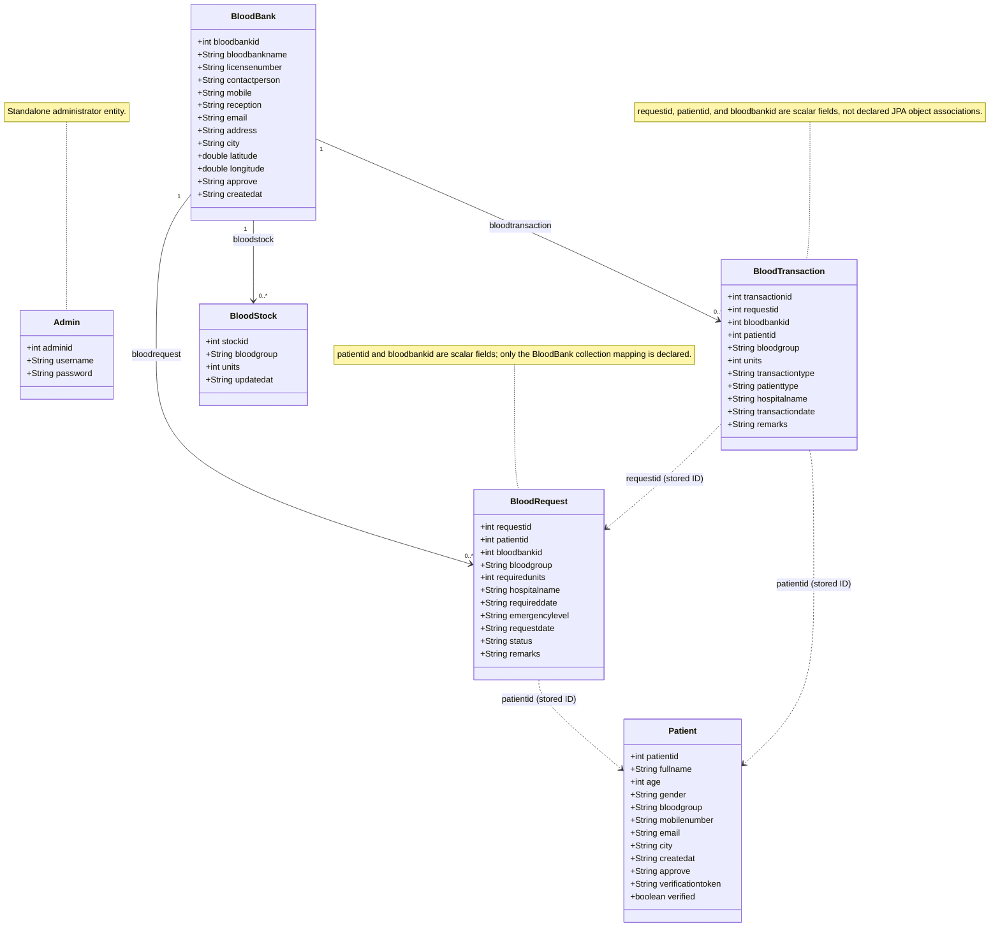

# Taskflow UML1

> This diagram documents the checked-out Smart Healthcare Resource project, not a Taskflow application.

## Healthcare resource domain class diagram

## Relationship notes

- The three solid associations are represented by `BloodBank`'s `@OneToMany` collections.
- Dashed dependencies show ID values stored by the class; they are not declared JPA object relationships.
- `Admin` is shown as a standalone entity because the model does not declare relationships for it.
